# Economy, Calculations, Data

```python
import impl as u
import pandas as pd
pd.set_option('display.max_columns', None)
```

<a name='gdp'></a>

## GDP

GDP calc seen below is computed as annualized quarterly growth rate,
quarter growth compared to previous quarter,
[annualized](https://www.fool.com/knowledge-center/how-to-calculate-the-annual-growth-rate-for-real-g.aspx).


```python
df = u.get_fred(1945,'GDPC1')
df['growann'] = (  (  (1+df.pct_change())**4  )-1.0  )*100.0
print (df['growann'].tail(5))
```

```text
2025-07-01    3.880334
2025-10-01    0.207735
2026-01-01    2.491776
2026-04-01    2.220208
2026-07-01    3.369619
Name: growann, dtype: float64
```

```python
df = u.get_fred(1970,'GDPC1')
df['gdpyoy'] = (df.GDPC1 - df.GDPC1.shift(4)) / df.GDPC1.shift(4) * 100.0
print (df[['gdpyoy']].tail(6))            
df = u.get_fred(1970,'CPIAUCNS')
df['inf'] = (df.CPIAUCNS - df.CPIAUCNS.shift(12)) / df.CPIAUCNS.shift(12) * 100.0
df['inf'] = df['inf'].interpolate()
print (df[['inf']].tail(6))            
```

```text
              gdpyoy
2025-04-01  2.420614
2025-07-01  2.600682
2025-10-01  2.046041
2026-01-01  2.639173
2026-04-01  2.191575
2026-07-01  2.065739
                 inf
2026-05-01  4.248674
2026-06-01  3.531425
2026-07-01  3.364825
2026-08-01  3.396548
2026-09-01  3.737685
2026-10-01  3.737685
```

## Wages and Unemployment

<a name='wages'></a>

Wages

```python
df3 = u.get_fred(1950,['ECIWAG'])
df3 = df3.dropna()
df3['ECIWAG2'] = df3.shift(4).ECIWAG
df3['wagegrowth'] = (df3.ECIWAG-df3.ECIWAG2) / df3.ECIWAG2 * 100.
print (df3['wagegrowth'].tail(4))
df3['wagegrowth'].plot(title='Wage Growth')
plt.savefig('wages.png')
```

```text
DATE
2024-10-01    3.710462
2025-01-01    3.369434
2025-04-01    3.559666
2025-07-01    3.584369
Name: wagegrowth, dtype: float64
```

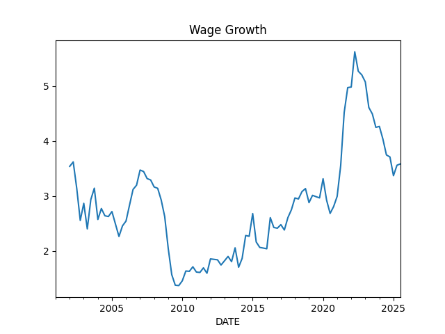

<a name='wagepayroll'></a>

Difference Between Wage Growth YoY and Total Payrolls, see [5]

```python
df = u.get_fred(1986,['PAYEMS','AHETPI'])
df['nfpyoy'] = (df.PAYEMS - df.PAYEMS.shift(12)) / df.PAYEMS.shift(12) * 100.0
df['wageyoy'] = (df.AHETPI - df.AHETPI.shift(12)) / df.AHETPI.shift(12) * 100.0
df[['wageyoy','nfpyoy']].plot()
plt.axvspan('01-09-1990', '01-07-1991', color='y', alpha=0.5, lw=0)
plt.axvspan('01-03-2001', '27-10-2001', color='y', alpha=0.5, lw=0)
plt.axvspan('22-12-2007', '09-05-2009', color='y', alpha=0.5, lw=0)
plt.axvspan('03-01-2020', '09-01-2020', color='y', alpha=0.5, lw=0)
plt.title('Wage Growth YoY and Total Payrolls')
print (df['wageyoy'].tail(5))
print (df['nfpyoy'].tail(5))
plt.savefig('pay-wage.png')
```

```text
2025-12-01    3.816047
2026-01-01    3.734979
2026-02-01    3.722888
2026-03-01    3.546099
2026-04-01    3.666774
Name: wageyoy, dtype: float64
2025-12-01    0.073271
2026-01-01    0.204716
2026-02-01    0.079591
2026-03-01    0.154063
2026-04-01    0.158375
Name: nfpyoy, dtype: float64
```

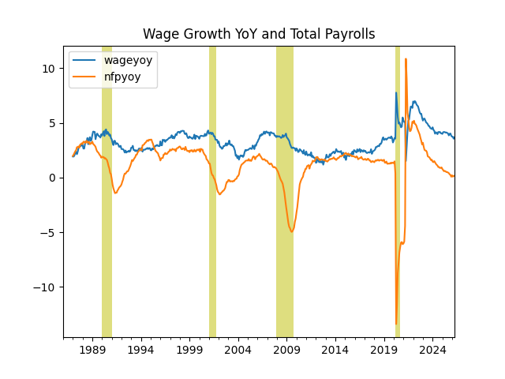

<a name='compprof'></a>

Compensation and Profits Comparison [5]

1) US Employee Compensation as a % of GVA of Domestic Corporations 

2) US Corporate Profits as a % of GDP

```python
df = u.get_fred(1965, ['A442RC1A027NBEA','A451RC1Q027SBEA','CP','GDP']).interpolate()
df['profgdp'] = (df.CP / df.GDP)*100.0
df['compgva'] = (df.A442RC1A027NBEA / df.A451RC1Q027SBEA)*100.0
u.two_plot(df, 'profgdp','compgva')
print (df[['profgdp','compgva']].tail(5))
plt.axvspan('01-12-1969', '01-11-1970', color='y', alpha=0.5, lw=0)
plt.axvspan('01-11-1973', '01-03-1975', color='y', alpha=0.5, lw=0)
plt.axvspan('01-01-1980', '01-11-1982', color='y', alpha=0.5, lw=0)
plt.axvspan('01-09-1990', '01-07-1991', color='y', alpha=0.5, lw=0)
plt.axvspan('01-03-2001', '27-10-2001', color='y', alpha=0.5, lw=0)
plt.axvspan('22-12-2007', '09-05-2009', color='y', alpha=0.5, lw=0)
plt.savefig('compprof.png')
```

```text
              profgdp    compgva
2025-01-01  11.103680  56.805512
2025-04-01  11.008092  56.056481
2025-07-01  11.548463  54.812580
2025-10-01  12.068435  53.783457
2026-01-01  11.904120  53.783457
```

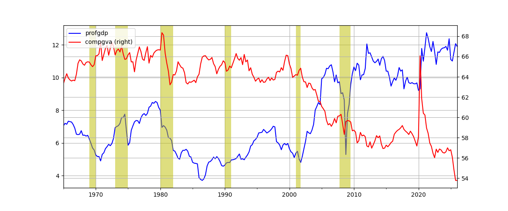

<a name='unempl'></a>

Unemployment

Calculation is based on [2]

```python
cols = ['LNS12032194','UNEMPLOY','NILFWJN','LNS12600000','CLF16OV','UNRATE','U6RATE']
df = u.get_fred(1986,cols)
df['REAL_UNEMP_LEVEL'] = df.LNS12032194*0.5 + df.UNEMPLOY + df.NILFWJN
df['REAL_UNRATE'] = (df.REAL_UNEMP_LEVEL / df.CLF16OV) * 100.0
pd.set_option('display.max_columns', None)
df1 = df.loc[df.index > '2005-01-01']
df1 = df1.interpolate()
df1[['UNRATE','U6RATE','REAL_UNRATE']].plot()
plt.title('Unemployment Rate')
print (df1[['UNRATE','U6RATE','REAL_UNRATE','REAL_UNEMP_LEVEL']].tail(5))
plt.savefig('unemploy.png')
```

```text
            UNRATE  U6RATE  REAL_UNRATE  REAL_UNEMP_LEVEL
2026-06-01     4.2     7.9     9.140106           15479.5
2026-07-01     4.1     7.9     9.011556           15238.0
2026-08-01     4.1     7.7     8.819216           14973.0
2026-09-01     4.2     7.6     8.897758           15149.5
2026-10-01     4.1     7.9     9.088193           15512.0
```

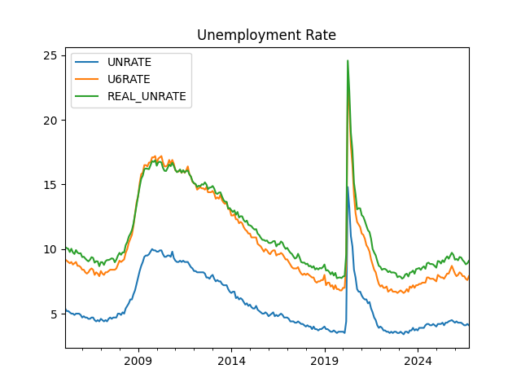

## Companies

<a name='pm'></a>

Profit Margins

Divide (1) by (2) as suggested in [4],

(1) Corporate Profits After Tax (without IVA and CCAdj) (CP)

(2) Real Final Sales of Domestic Product (FINSLC1)


```python
df = u.get_fred(1980, ['CP','FINSLC1']); df = df.interpolate()
df = df.dropna()
df['PM'] = df['CP'] / df['FINSLC1'] * 100.0
df.PM.plot()
print (df.tail(4))
plt.savefig('profitmargin.png')
```

```text
                  CP    FINSLC1         PM
2025-10-01  3783.725  24132.356  15.679053
2026-01-01  3948.352  24270.589  16.268052
2026-04-01  4279.937  24436.345  17.514636
2026-07-01  4279.937  24541.742  17.439418
```

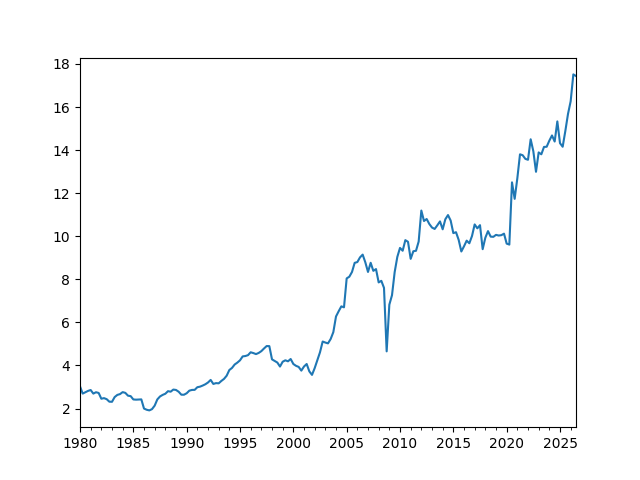

## Finance

Dollar

<a name='dollar'></a>

```python
df = u.get_yahoo_ticker(1980, "DX-Y.NYB").interpolate()
df.tail(1000).plot()
plt.grid(True)
print (df.tail(4))
plt.savefig('dollar.png')
```

```text
              DX-Y.NYB
2026-11-09  101.650002
2026-11-10  102.230003
2026-11-11  102.910004
2026-11-12  103.147003
```

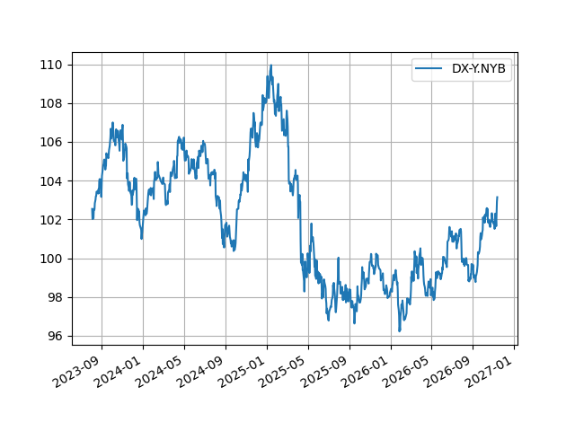

<a name='schiller'></a>

Schiller P/E (Price to Earnings) 

```python
df = pd.read_csv('../../mbl/2026/schiller.csv',index_col='Date',parse_dates=True)
df['real_price'] = df['S&P Comp P'] * df['CPI'].iloc[-1] / df['CPI']
df['real_earnings'] = df['Earnings E'] * df['CPI'].iloc[-1] / df['CPI']
df['real_earnings_10y_avg'] = df['real_earnings'].rolling(window=120).mean()
df['CAPE'] = df['real_price'] / df['real_earnings_10y_avg']
df['CAPE'].tail(400).plot()
print (df['CAPE'].tail(4))
plt.savefig('schiller2.jpg')
```

```text
Date
2026-03-01    36.789586
2026-04-01    37.874575
2026-05-01    39.808584
2026-06-01    39.837161
Name: CAPE, dtype: float64
```

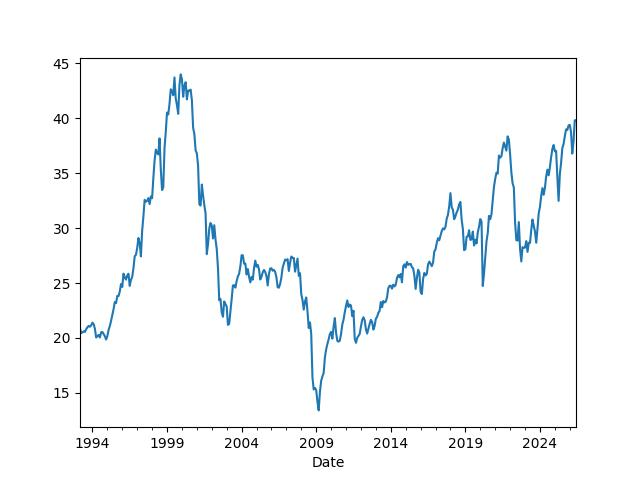

Overlay Schiller's P/E ratio on top SP 500 10-year returns [1] since
1920s. Lows and highs arrive 10 years after the market is most
expensive and cheapest, respectively. The two graphs should show
perfect reverse correlation. 

```python
df = pd.read_csv('../../mbl/2026/schiller.csv', index_col='Date', parse_dates=True)
df['real_price'] = df['S&P Comp P'] * df['CPI'].iloc[-1] / df['CPI']
df['real_earnings'] = df['Earnings E'] * df['CPI'].iloc[-1] / df['CPI']
df['real_earnings_10y_avg'] = df['real_earnings'].rolling(window=120).mean()
df['CAPE'] = df['real_price'] / df['real_earnings_10y_avg']
df['return_10y_trailing'] = (df['real_price'] / df['real_price'].shift(120)) ** (1/10) - 1
df['CAPE_shifted'] = df['CAPE'].shift(120)
df_filtered = df.loc['1920-01-01':]
u.two_plot(df_filtered, 'CAPE_shifted', 'return_10y_trailing')
plt.axvspan('1929-08-01', '1933-03-01', color='y', alpha=0.5, lw=0)
plt.axvspan('1960-04-01', '1961-02-01', color='y', alpha=0.5, lw=0)
plt.axvspan('1961-12-12', '1962-06-26', color='y', alpha=0.5, lw=0)
plt.axvspan('1969-12-01', '1970-11-01', color='y', alpha=0.5, lw=0)
plt.axvspan('1990-09-01', '1991-07-01', color='y', alpha=0.5, lw=0)
plt.axvspan('2001-03-01', '2001-10-27', color='y', alpha=0.5, lw=0)
plt.axvspan('2007-12-22', '2009-05-09', color='y', alpha=0.5, lw=0)
plt.axvspan('2020-02-01', '2020-07-01', color='y', alpha=0.5, lw=0)
plt.savefig('schiller.jpg')
```

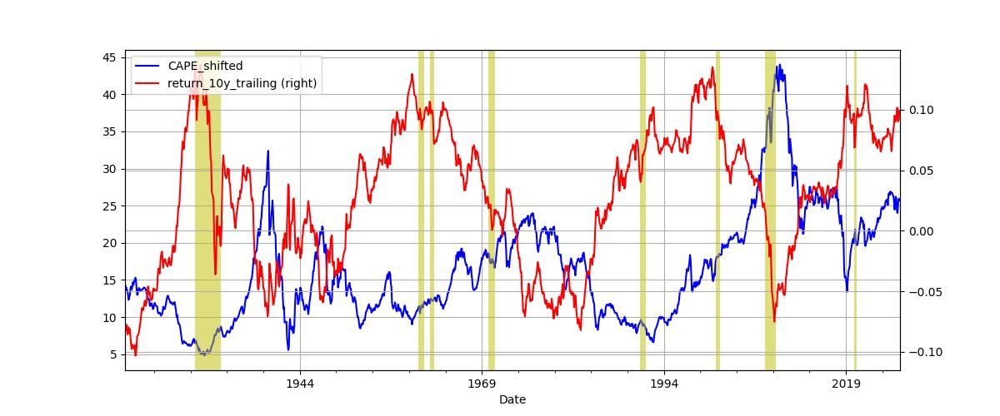

<a name='junkbond'></a>

Junk Bond Yields

```python
df = u.get_fred(1980,'BAMLH0A2HYBEY')
print (df.tail(6))
df.plot()
plt.savefig('junkbond.png')
```

```text
            BAMLH0A2HYBEY
2026-11-03           8.36
2026-11-04           8.19
2026-11-05           8.28
2026-11-06           8.25
2026-11-09           8.17
2026-11-11           8.29
```

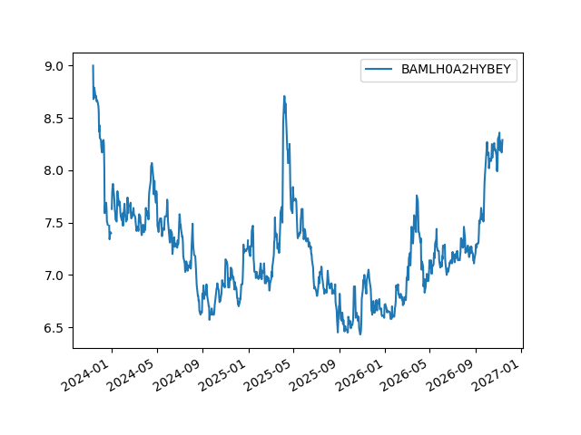

<a name='treas'></a>

3 Month, 2 and 10 Year Treasury Rates

```python
df = u.get_fred(2020,['DGS3MO','DGS2','DGS10','FEDFUNDS'])
df = df.interpolate()
df.plot()
#plt.axvspan('01-09-1990', '01-07-1991', color='y', alpha=0.5, lw=0)
#plt.axvspan('01-03-2001', '27-10-2001', color='y', alpha=0.5, lw=0)
#plt.axvspan('22-12-2007', '09-05-2009', color='y', alpha=0.5, lw=0)
print (df.tail(3))
plt.savefig('treasuries.png')
```

```text
            DGS3MO  DGS2  DGS10  FEDFUNDS
2026-11-05    4.17  4.46   4.84      3.88
2026-11-06    4.19  4.51   4.86      3.88
2026-11-09    4.24  4.56   4.88      3.88
```

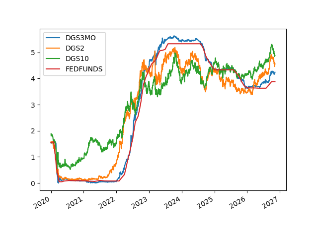

<a name='tcurve'></a>

Treasury Curve

```python
df = u.get_fred(1980,['DGS2','DGS10'])
df = df.interpolate()
df['inv'] = df.DGS10 - df.DGS2
df['inv'].plot(grid=True)
print (df['inv'].tail(4))
plt.axvspan('01-09-1990', '01-07-1991', color='y', alpha=0.5, lw=0)
plt.axvspan('01-03-2001', '27-10-2001', color='y', alpha=0.5, lw=0)
plt.axvspan('22-12-2007', '09-05-2009', color='y', alpha=0.5, lw=0)
plt.savefig('tcurve.jpg')
```

```text
2026-05-04    0.50
2026-05-05    0.50
2026-05-06    0.49
2026-05-07    0.49
Name: inv, dtype: float64
```

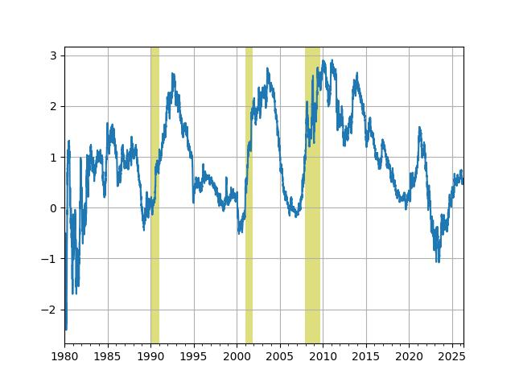

```python
df = u.get_fred(2008,['DGS2','DGS10'])
df = df.interpolate()
df['inv'] = df.DGS10 - df.DGS2
df['inv'].plot(grid=True)
print (df.inv.tail(4))
plt.savefig('tcurve2.jpg')
```

```text
DATE
2026-01-19    0.675
2026-01-20    0.700
2026-01-21    0.660
2026-01-22    0.650
Name: inv, dtype: float64
```

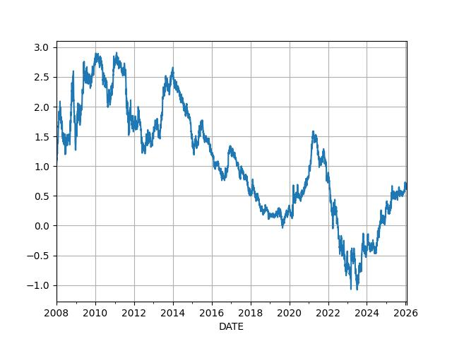

<a name='vix'></a>

VIX

```python
df = u.get_yahoo_ticker(2000,"^VIX")
df.plot()
plt.axvspan('22-12-2007', '09-05-2009', color='y', alpha=0.5, lw=0)
print (df.tail(7))
plt.savefig('vix.png')
```

```text
                 ^VIX
2026-05-01  16.990000
2026-05-04  18.290001
2026-05-05  17.379999
2026-05-06  17.389999
2026-05-07  17.080000
2026-05-08  17.190001
2026-05-11  18.240000
```

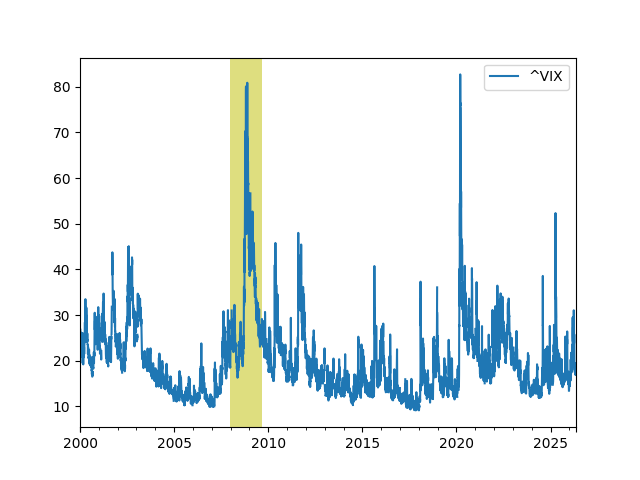

<a name='fear'></a>

Fear Index - Rolling 200d Correlation

```python
df = u.get_yahoo_tickers(2010, ["^SP100","SPY","^SPXEW"])
returns = df.pct_change()
rolling_corr = returns.rolling(window=200).corr()
plot_df = pd.DataFrame(index=df.index)
plot_df['OEX-SPX'] = rolling_corr.xs('^SP100', level=1)['SPY']
plot_df['SPW-OEX'] = rolling_corr.xs('^SPXEW', level=1)['^SP100']
plot_df['SPX-SPW'] = rolling_corr.xs('SPY', level=1)['^SPXEW']
plt.figure(figsize=(12, 7))
plt.plot(plot_df['OEX-SPX'], color='black', label='OEX-SPX', linewidth=1.5)
plt.plot(plot_df['SPW-OEX'], color='#00adef', label='SPW-OEX', linewidth=1.5)
plt.plot(plot_df['SPX-SPW'], color='#135a28', label='SPX-SPW', linewidth=1.5)
plt.ylim(0.5, 1.1)
plt.grid(axis='y', alpha=0.3)
plt.legend(loc='upper center', bbox_to_anchor=(0.5, -0.1), ncol=3, frameon=False)
for spine in ['top', 'right', 'left']:
    plt.gca().spines[spine].set_visible(False)

plt.tight_layout()
plt.savefig('fear.jpg')
```

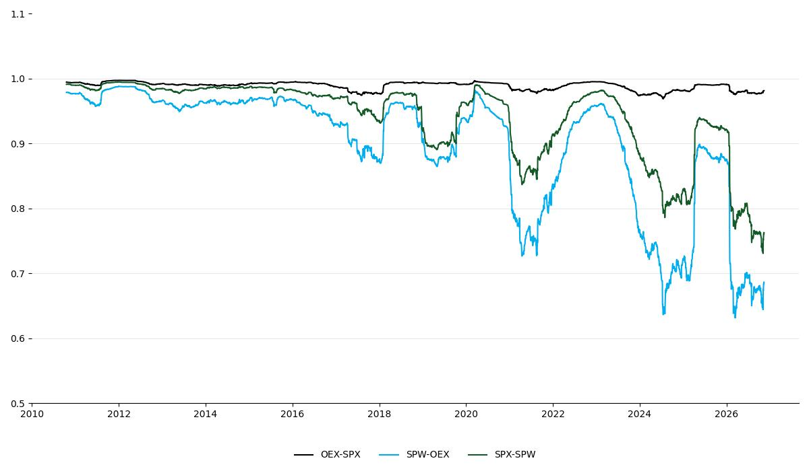


## Wealth, Debt

<a name='credit'></a>

Private Debt to GDP Ratio

```python
df = u.get_fred(1960,['GDPC1','QUSPAMUSDA'])
df = df.interpolate()
df['Credit to GDP'] = (df.QUSPAMUSDA / df.GDPC1)*100.0
df['Credit to GDP'].plot()
plt.axvspan('01-09-1990', '01-07-1991', color='y', alpha=0.5, lw=0)
plt.axvspan('01-03-2001', '27-10-2001', color='y', alpha=0.5, lw=0)
plt.axvspan('22-12-2007', '09-05-2009', color='y', alpha=0.5, lw=0)
plt.axvspan('2020-02-01', '2020-05-01', color='y', alpha=0.5, lw=0)
plt.savefig('creditgdp.png')
print (df['Credit to GDP'].tail(4))
```

```text
DATE
2024-10-01    177.039165
2025-01-01    178.115572
2025-04-01    177.673874
2025-07-01    175.781853
Freq: QS-OCT, Name: Credit to GDP, dtype: float64
```

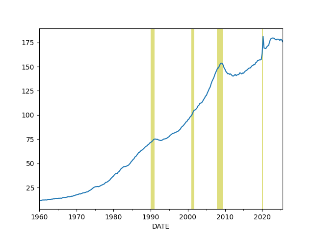

<a name='debt'></a>

Total Consumer Credit Outstanding as % of GDP

```python
df = u.get_fred(1980,['TOTALSL','GDP'])
df = df.interpolate(method='linear')
df['debt'] =   df.TOTALSL / df.GDP * 100.0
print (df.debt.tail(4))
df.debt.plot()
plt.axvspan('01-09-1990', '01-07-1991', color='y', alpha=0.5, lw=0)
plt.axvspan('01-03-2001', '27-10-2001', color='y', alpha=0.5, lw=0)
plt.axvspan('22-12-2007', '09-05-2009', color='y', alpha=0.5, lw=0)
plt.axvspan('2020-02-01', '2020-05-01', color='y', alpha=0.5, lw=0)
plt.savefig('debt.png')
```

```text
2025-12-01    16081.263402
2026-01-01    16030.888061
2026-02-01    16058.652842
2026-03-01    16136.675191
Freq: MS, Name: debt, dtype: float64
```

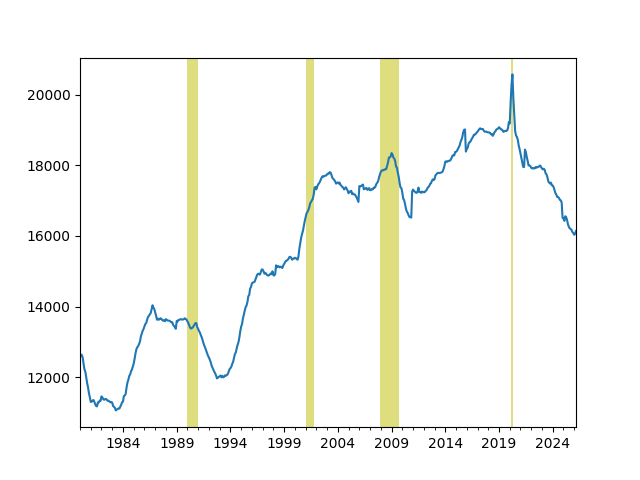

<a name='gini'></a>

Wealth Inequality - GINI Index

Code taken from [3]

```python
def gini(pop,val):
    pop = list(pop); pop.insert(0,0.0)
    val = list(val); val.insert(0,0.0)        
    poparg = np.array(pop)
    valarg = np.array(val)
    z = valarg * poparg;
    ord = np.argsort(val)
    poparg    = poparg[ord]
    z = z[ord]
    poparg    = np.cumsum(poparg)
    z    = np.cumsum(z)
    relpop = poparg/poparg[-1]
    relz = z/z[-1]    
    g = 1 - np.sum((relz[0:-1]+relz[1:]) * np.diff(relpop))
    return np.round(g,3)

cols = ['WFRBLT01026', 'WFRBLN09053','WFRBLN40080','WFRBLB50107']
df = u.get_fred(1989,cols)
df = df.interpolate()
p = [0.01, 0.09, 0.40, 0.50]
g = df.apply(lambda x: gini(p,x),axis=1)
print (g.tail(4))
g.plot()
plt.xlim('1990-01-01','2026-01-01')
plt.axvspan('1993-01-01','1993-01-01',color='y')
plt.axvspan('2001-01-01','2001-01-01',color='y')
plt.axvspan('2009-01-01','2009-01-01',color='y')
plt.axvspan('2017-01-01','2017-01-01',color='y')
plt.axvspan('2021-01-01','2021-01-01',color='y')
plt.axvspan('2025-01-01','2025-01-01',color='y')
plt.text('1990-07-01',0.44,'HW')
plt.text('1994-10-01',0.46,'Clinton')
plt.text('2003-12-01',0.47,'W')
plt.text('2011-01-01',0.44,'Obama')
plt.text('2018-01-01',0.42,'DJT')
plt.text('2020-03-01',0.48,'Biden')
plt.text('2023-06-01',0.42,'DJT')
plt.savefig('gini.png')
```

```text
2025-07-01    0.444
2025-10-01    0.444
2026-01-01    0.443
2026-04-01    0.447
dtype: float64
```

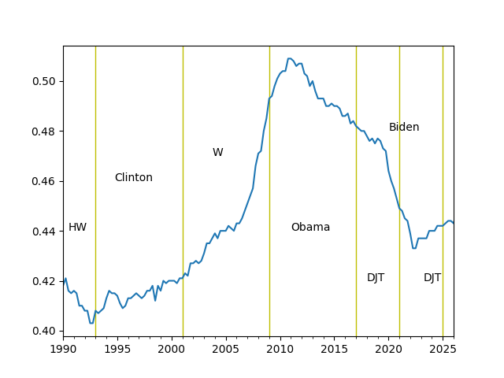

<a name='top10'></a>

Percentage of Wealth Held by Top 10%

```python
cols = ['WFRBLT01026', 'WFRBLN09053','WFRBLN40080','WFRBLB50107']
df = u.get_fred(1970,cols)
df = df.interpolate()

df['Total'] =  df['WFRBLT01026'] + df['WFRBLN09053'] + df['WFRBLB50107'] + df['WFRBLN40080']
df['Top 10%'] = (df['WFRBLT01026'] + df['WFRBLN09053']) * 100 / df.Total 
df['Bottom 50%'] = (df['WFRBLB50107'] * 100) / df.Total 

print (df[['Top 10%','Bottom 50%']].tail(4))
df[['Top 10%']].plot()
plt.ylim(50,100)
plt.savefig('top10-2.jpg')
```

```text
              Top 10%  Bottom 50%
2024-10-01  67.410590    2.480988
2025-01-01  67.182930    2.490884
2025-04-01  67.506484    2.482505
2025-07-01  68.139687    2.458570
```

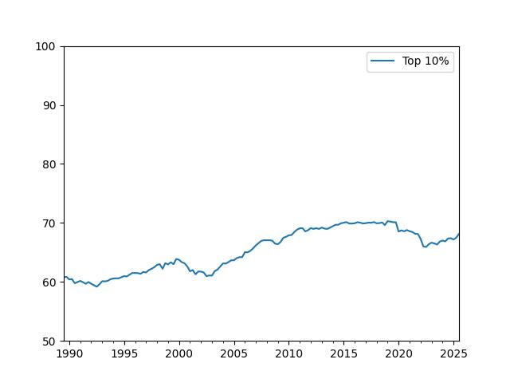

<a name='livingst'></a>

## Living Standards Index

We divide income by seperate spending items, you would get "units of
that item can be bought by a regular person". If median income in 2010
is 100, education is 10, I could buy 10 units of education for that
year, same for housing etc.

`MEHOINUSA646N` - Median Household Income in the US, `MSPUS` - Median
Sales Price of Houses Sold, `HLTHSCPCHCSA` - Health Expenditures per
Capita, `CUSR0000SEEB` - Tuition, `CPIAUCSL` Consumer Price Index, for
everyday shopping. 

```python
targets = ['MSPUS','HLTHSCPCHCSA','CUSR0000SEEB','CPIAUCSL']
income = ['MEHOINUSA646N']
df = u.get_fred(1992, income + targets)
df['MEHOINUSA646N'] = df['MEHOINUSA646N'].interpolate(method='linear')
df = df.interpolate(method='linear')
ratios_df = df.copy()
for col in targets:
    ratios_df[col] = ratios_df[income[0]] / ratios_df[col]
normalized_df = ratios_df[targets] / ratios_df[targets].iloc[0]
ratios_df['super_index'] = normalized_df.mean(axis=1)
ratios_df['super_index'].plot(title='Living Standards Index', grid=True)
print (ratios_df['super_index'].tail(3))
plt.savefig('livingst.jpg')
```

```text
2026-08-01    0.889256
2026-09-01    0.885523
2026-10-01    0.883520
Freq: MS, Name: super_index, dtype: float64
```

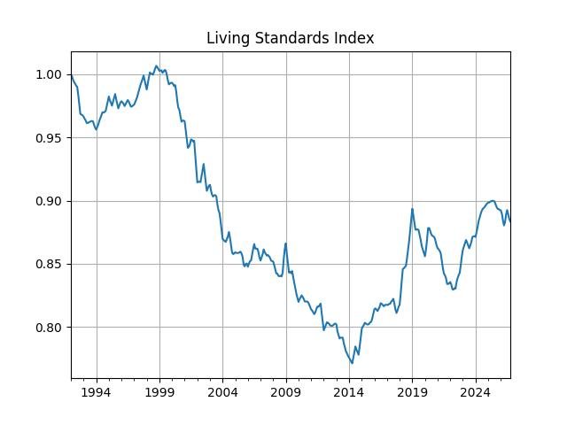

## Real Estate

<a name='medhouse'></a>

Median house prices

```python
df = u.get_fred(1992,"MSPUS")
df.plot()
print (df.tail(3))
plt.savefig('medhouse.jpg')
```

```text
               MSPUS
2026-01-01  408500.0
2026-04-01  413500.0
2026-07-01  393300.0
```

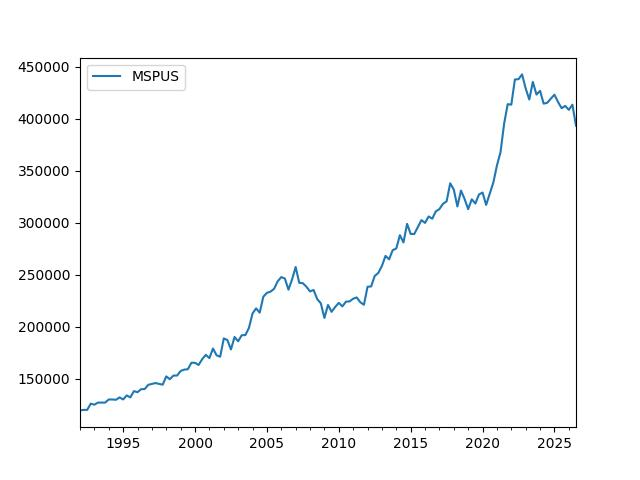

<a name='chex'></a>

## Foreign

Chinese Exports

```python
df = u.get_fred(2010,['XTEXVA01CNM667S']); df.plot()
plt.savefig('exchina.jpg')
print (df.tail(5))
```

```text
            XTEXVA01CNM667S
2026-04-01     3.594083e+11
2026-05-01     3.789126e+11
2026-06-01     3.947403e+11
2026-07-01     3.875077e+11
2026-08-01     3.962539e+11
```

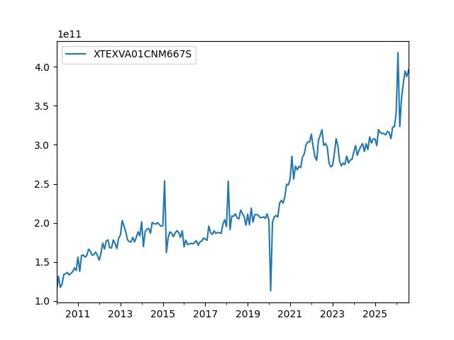

---

References, Notes

[1] [Schiller](http://www.econ.yale.edu/~shiller/data.htm)

[2] [Komlos](https://www.longfinance.net/news/pamphleteers/true-us-unemployment-rate-march-2019/)

[3] [Mathworks](https://www.mathworks.com/matlabcentral/mlc-downloads/downloads/submissions/28080/versions/1/previews/gini.m/index.html)

[4] [Philosophical Economics](https://www.philosophicaleconomics.com/2014/03/foreignpm/)

[5] [Hedgeye](https://app.hedgeye.com/mu/he_qio_4q19_10-3-2019?encoded_data=ft9F,6yjgJ3+iFdaasKwdMTJVgzgnZlI=,)

