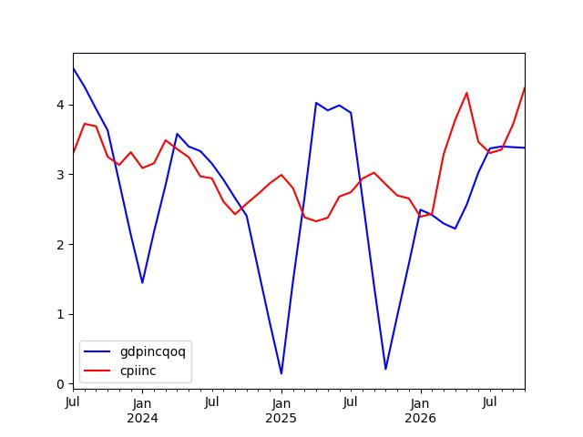
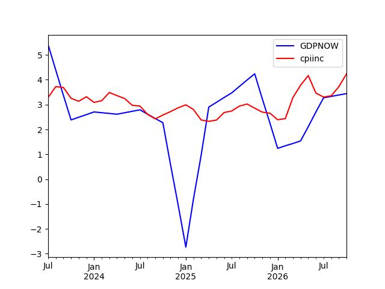
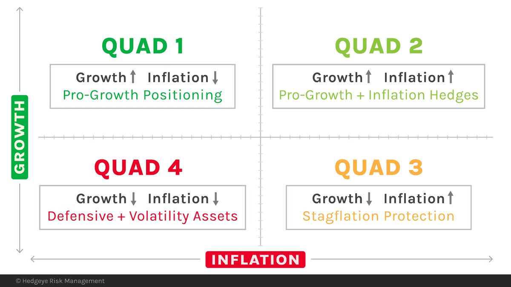
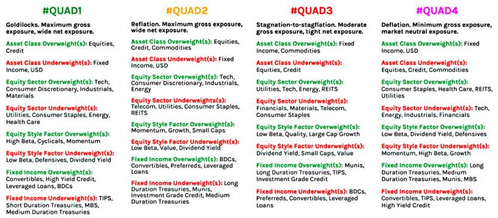

# Growth and Inflation

### Calculation

```python
import impl as u
df = u.get_fred(1970,['GDPNOW','GDPC1','CPIAUCSL'])
```

```python 
df2 = df.interpolate(method='slinear',limit_direction='both',fill_value='extrapolate')
df2['gdpinc'] = df2['GDPC1'].pct_change(12)*100
df2['gdpincqoq'] = (  (  (1+df2['GDPC1'].pct_change(3))**4  )-1.0  )*100.0
df2['cpiinc'] = df2['CPIAUCSL'].pct_change(12)*100
df2[['gdpincqoq','cpiinc']].tail(40).plot(color=['blue', 'red'])
print (df2[['gdpincqoq','cpiinc']].tail(10))
plt.savefig('g_and_i.jpg')
```

```text
            gdpincqoq    cpiinc
2026-01-01   2.491776  2.391201
2026-02-01   2.416689  2.434004
2026-03-01   2.294475  3.285958
2026-04-01   2.220208  3.779246
2026-05-01   2.566153  4.166615
2026-06-01   3.024411  3.463531
2026-07-01   3.369619  3.303856
2026-08-01   3.397678  3.353016
2026-09-01   3.387982  3.717251
2026-10-01   3.378651  4.234689
```



GPDNow

```python
df2[['GDPNOW','cpiinc']].tail(40).plot(color=['blue', 'red'])
plt.savefig('g_and_i2.jpg')
```



```python
print (df2[['GDPNOW','gdpincqoq']].tail(8)  )
```

```text
              GDPNOW  gdpincqoq
2026-03-01  1.436391   2.294475
2026-04-01  1.540000   2.220208
2026-05-01  2.111022   2.566153
2026-06-01  2.701078   3.024411
2026-07-01  3.272100   3.369619
2026-08-01  3.328945   2.243289
2026-09-01  3.385789   1.095483
2026-10-01  3.440800   0.000000
```


### Quads



### Investment Strategies



See Hedgeye's site for more details